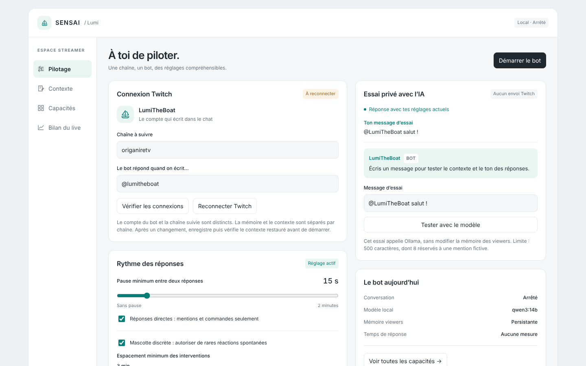
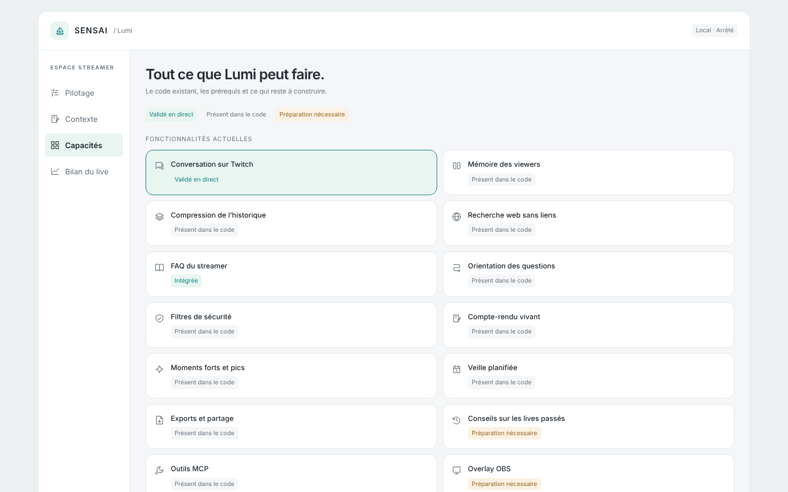

# Sensai

An AI assistant for Twitch streamers that runs entirely on the streamer's computer. It joins the chat as a bot, answers viewers while remembering each of them, answers questions about the channel from its FAQ, searches the web for current questions, and blocks manipulation attempts. The language model runs locally through [Ollama](https://ollama.com); the agent logic is written by the team, without an LLM framework.



**Python · Ollama (Qwen3 14B, bge-m3 embeddings) · Twitch IRC · SQLite · Flask · MCP · DuckDuckGo search · OBS WebSocket**

Epitech project, team of 4. The dashboard and the full user guide are in French: [doc/README.fr.md](doc/README.fr.md).

## Highlights

- **Per-viewer memory.** Each viewer has their own history and facts, stored in SQLite and kept across restarts.
- **Fits in a token budget.** Older messages are summarised so the conversation stays within the model's context.
- **Router.** Each question goes to the conversation agent, the channel documents (RAG with `bge-m3`, sources cited) or the web.
- **Guardrails.** Prompt injections (even obfuscated), doxxing and harassment are refused; personal data is masked on the way in and out. An adversarial suite of 53 attacks checks them.
- **Tools.** A home-made MCP client and server, so the model can read viewer profiles, the FAQ and the stream report, and any MCP client can use the stream's data.
- **For the streamer.** A live stream report, exports to Markdown, JSON, HTML or PDF, scheduled web watch reports and an OBS overlay.



## Quick start

Requires Python 3.10+ and Ollama.

```sh
ollama pull qwen3:14b     # chat model
ollama pull bge-m3        # embeddings for the FAQ search
python3 -m venv .venv && .venv/bin/pip install -r requirements.txt

.venv/bin/python -m src.agents.chat_agent --local   # simulated chat in the terminal, no Twitch account needed
.venv/bin/python -m src.dashboard                   # local dashboard on http://127.0.0.1:8766
.venv/bin/python -m src.cli                         # streamer CLI: /ingest, /ask, /report, /export...
```

Connecting the bot to a real Twitch channel and to OBS is described in the [user guide](doc/README.fr.md#connecter-twitch-et-obs).

## Tests

```sh
python3 -m pytest -q                      # unit tests, no Ollama needed
python3 -m tests.adversarial.run          # attacks against the guardrails
```

## Project layout

- `src/agents/` - the Twitch chat agent, the router and the mascot mode.
- `src/core/` - Ollama client, memory, guardrails, RAG (ingestion, search, storage), exports.
- `src/mcp/` - MCP client and Sensai's MCP server.
- `src/tools/` - web search, OBS, stream report, scheduled reports.
- `src/dashboard.py`, `src/dashboard_ui/` - the local dashboard.
- `config/`, `config.yaml`, `prompts/` - settings and instructions given to the model.
- `doc/` - user guide, chat agent design, user stories, evaluation reports.

## Team and contributions

ColoMiel, Origanire, Hexoneer and Kevin Huynh ([@Nivek-Hyn](https://github.com/Nivek-Hyn)).

- Kevin Huynh: the Twitch chat agent: the IRC connection and message parsing, answering when the bot is mentioned, the per-viewer memory that survives restarts, the token budget and the compression of older history, the moderator-only `!remember` command, viewer activity statistics, and the code documentation with Doxygen.
